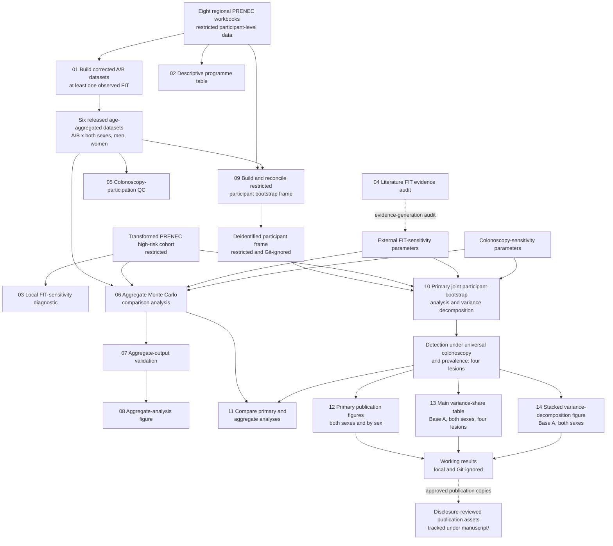

# PRENEC analysis pipeline

## Data flow



## Execution order

The current primary analysis is the authorised-data workflow formed by Stages
09--14. Its dependency order is:

```text
09 -> 10 -> 12
         -> 13
         -> 14
06 -> 11 <- 10
```

Stage 09 must precede Stage 10. Stages 12--14 read the outputs of Stage 10 and
can then be run independently. Stage 11 is a methodological crosswalk and
requires results from both Stages 06 and 10; it does not define the primary
estimates.

All of Stages 09--14 require an authorised secure environment containing the
participant-level PRENEC inputs. They are intentionally not invoked by
`scripts/run_all.R`, because the public clone cannot contain those inputs. The
`run_all.R` helper runs the aggregate Stages 06--08 from the released A/B
products; with `--rebuild-intermediate`, it first runs Stages 01--02. Scripts
03--05 remain diagnostic or evidence-generation checks.

The participant frame created by Stage 09, bootstrap draws, full result tables
and RDS files, manifests, and other working outputs from Stages 09--14 remain
excluded by `.gitignore`. Scripts 12 and 14 write their working files under the
ignored `results/joint_bootstrap/` tree. The narrow exception is the approved
publication set copied after disclosure review: five PDFs under
`manuscript/figures/` and three aggregate plot-data TSVs under
`manuscript/source_data/` are tracked. No other generated output should be
committed without a separate disclosure review.

## Stage definitions

### 01: A/B database construction

- Reads the eight regional Excel workbooks from `PRENEC_DATA_DIR`.
- Harmonises types using the Santiago workbook as the template.
- Derives enrolment age, FIT rounds, lesion size, histological risk, and the
  qualifying colonoscopy window.
- Restricts the analytical cohort to average-risk participants aged 50--75
  years with at least one observed FIT. Participants with no observed FIT are
  excluded from `N` because they cannot enter the FIT-to-colonoscopy pathway.
- For participants with two FIT results, assigns one result to A and the other
  to B using a reproducible complementary randomisation; a single observed FIT
  is carried into both assignments.
- Produces the low-risk adenoma, high-risk adenoma, any-adenoma, and colorectal
  cancer counts required by the primary analysis.
- Produces exactly six release workbooks under `data/intermediate`: both-sex,
  men, and women datasets for A and B.
- Writes audit products outside the released-workbook allowlist.

### 02: Descriptive analysis

Reads the regional workbooks independently and produces the programme-level
descriptive table for participants without reported family history of
colorectal cancer.

### 03--05: Diagnostic and evidence checks

These stages document local FIT sensitivity, the low-risk FIT meta-analysis,
and colonoscopy participation. Their exported files are audit products rather
than the primary Stage 10 result set.

### 06--08: Aggregate comparison pathway

Stage 06 uses the six A/B aggregates, the transformed high-risk PRENEC cohort,
and literature parameters to run the earlier Monte Carlo implementation. Stage
07 validates its outputs, and Stage 08 creates its multipanel figure. This
pathway is retained for reproducibility and for the Stage 11 comparison; it is
not the current primary uncertainty analysis.

### 09: Restricted participant frame

- Rebuilds the analytical cohort from the eight restricted regional workbooks.
- Retains only average-risk participants aged 50--75 with at least one observed
  FIT, giving the prespecified denominator `N = 31,104` (`8,267` men and
  `22,837` women).
- Removes direct identifiers and retains one row per analytical participant,
  including both FIT assignments, qualifying colonoscopy, sex, age group, and
  the four lesion indicators.
- Reconstructs A/B counts and requires exact agreement with all six released
  age-aggregated datasets before saving.
- Writes the frame to `PRENEC_BOOTSTRAP_FRAME`. The frame remains restricted
  participant-level health data despite deidentification and is Git-ignored.

### 10: Primary joint participant-bootstrap analysis

- Resamples the observed participant patterns within sex-by-age strata by
  multinomial sampling.
- Uses one bootstrap bank across A/B assignments, low-risk adenoma, high-risk
  adenoma, any adenoma, colorectal cancer, both-sex and sex-specific
  populations, and both FIT-sensitivity scenarios. This preserves their
  empirical dependence.
- Recalculates FIT positivity, colonoscopy participation, and lesion yield from
  the same resampled participants. The participation correction is retained in
  its algebraically equivalent nested-count form.
- Draws FIT- and colonoscopy-sensitivity uncertainty independently of the
  participant bootstrap.
- Reports plug-in point estimates and equal-tail percentile 95% intervals for
  lesion detection under universal colonoscopy and prevalence.
- Exports four uncertainty runs: screening data only, FIT sensitivity only,
  colonoscopy sensitivity only, and full analysis.
- Computes the exact additive decomposition of log-scale variance under the
  stated independence assumption. Colonoscopy-sensitivity variance contributes
  to prevalence but not to lesion detection under universal colonoscopy.

### 11: Comparison with the aggregate implementation

Strictly maps the 96 Stage 06 estimates to their 96 full-analysis Stage 10
counterparts and exports point differences, interval differences, and
interval-width ratios. This is a comparison product only and does not modify
either analysis.

### 12: Primary estimate figures

Creates the four-lesion figure for both sexes and the corresponding
supplementary figure for men and women. Both figures show lesion detection under
universal colonoscopy and prevalence for assignments A/B and the two FIT
sensitivity scenarios. Points are plug-in estimates and intervals are the full
joint-bootstrap equal-tail percentile intervals. The script writes working
formats and plotted data under the ignored results directory; only the approved
PDF and aggregate plotted-data TSV copies under `manuscript/` are tracked.

### 13: Variance-share table

Creates the Base A, both-sex table for all four lesion endpoints and both
estimands. It reports the percentage contributions of screening-data, FIT-
sensitivity, and colonoscopy-sensitivity uncertainty to the additive log-scale
variance for each FIT-sensitivity scenario.

### 14: Variance-decomposition figure

Creates the stacked-bar variance-source figure for Base A and both sexes from
the Stage 10 variance shares. The current display includes low-risk adenoma,
high-risk adenoma, and colorectal cancer for both estimands and both FIT-
sensitivity scenarios; the Stage 10 decomposition and Stage 13 table retain all
four endpoints, including any adenoma. Figure files and their plotted-data TSV
are first generated in the ignored results directory. Only the
disclosure-reviewed PDF and aggregate plotted-data TSV copies under
`manuscript/` are tracked; the other working formats remain ignored.
